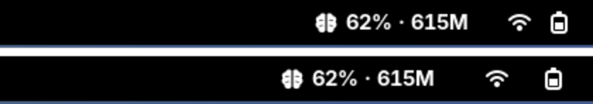

# Roomy Panel

A tiny GNOME Shell extension that gives the top bar macOS-style breathing room.



## Why

GNOME packs the right side of the top bar tightly: the Wi-Fi, Bluetooth and battery icons sit only 4px apart, and every panel button gets 12px of padding. Next to the macOS menu bar, where items sit roughly 16–20px apart, it looks cramped, especially once you add a few extension indicators and tray icons.

Roomy Panel is CSS only. There's no logic and nothing runs in the background. Because it ships as an extension rather than an edited theme, it survives GNOME and theme updates and is easy to turn off.

| | GNOME default | Roomy Panel |
|---|---|---|
| Gap between system status icons (Wi-Fi, Bluetooth, battery…) | 4px | 16px |
| Panel button padding (natural / minimum) | 12px / 6px | 16px / 8px |
| Battery icon to battery percentage | 0px | 4px |

The wider button padding applies to everything in the top bar: extension indicators, tray icons, the clock and so on.

## Install

```sh
git clone https://github.com/jasperblues/gnome-roomy-panel.git \
  ~/.local/share/gnome-shell/extensions/roomy-panel@jasperblues.github.io
```

Log out and back in (GNOME on Wayland only discovers new extensions at login), then:

```sh
gnome-extensions enable roomy-panel@jasperblues.github.io
```

Supports GNOME Shell 50 and 51.

## Tuning

All the numbers are in [`stylesheet.css`](stylesheet.css). Edit them to taste, then log out and back in. GNOME doesn't reload an extension's stylesheet while it's running.

## See also

- [Headroom](https://github.com/jasperblues/gnome-headroom): AI plan limits in the top bar (shown in the screenshot).
- [Polite Focus](https://github.com/jasperblues/gnome-polite-focus): macOS-style focus for windows that ask for attention, with a mute list.

## License

MIT. See [LICENSE](LICENSE).
